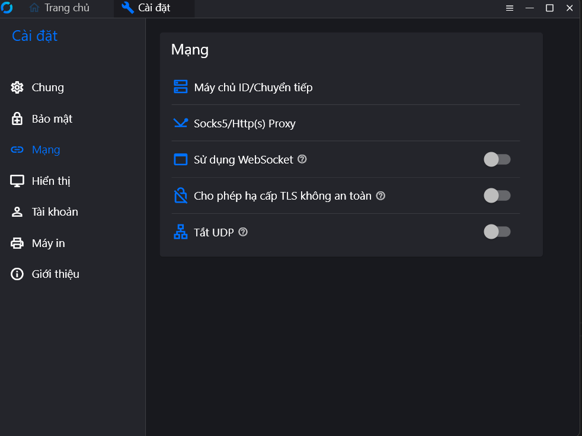

# Hướng dẫn triển khai RustDesk Server

## Yêu cầu
- Windows 11
- Docker Desktop (đã bật WSL2 Integration)
- Quyền Administrator

## Các bước triển khai

### Bước 1: Khởi động server
```powershell
cd D:\rustdesk-server <vị trí thư mục lưu git của bạn>
docker compose up -d
docker compose ps
### Bước 2: Cập nhật proxy
cd D:\rustdesk-server\scripts
.\update-portproxy.ps1
### Bước 3: Lấy public key
xem trong logs của docker desktop ở hbbs có phần key
### Bước 4: Cấu hình client
mở rustdk vào phần setting -> network -> câu hình 
ID Server: <IP_Windows_VMnet8>:21116
Relay Server: <IP_Windows_VMnet8>:21117
Key: <public key ở bước 3>


---

# 5. BUỔI 3 – Cài đặt môi trường build

Phần này dành cho **Bạn 1 (Client Developer)**, phụ trách build và tùy biến RustDesk Client trên Windows.

> **Lưu ý quan trọng:** Các lệnh bên dưới đã được điều chỉnh theo quá trình build thực tế của nhóm. Một số lệnh trong hướng dẫn ban đầu cần thay đổi, đặc biệt là vị trí `vcpkg`, Cargo cache/target và tham số `--features "inline"`.

## 5.1. Chọn hướng build

| Hướng | Công cụ | Kết quả |
| :--- | :--- | :--- |
| A. Linux binary | Docker builder | Binary chạy trên Ubuntu |
| **B. Windows `.exe`** | **Rust + VS Build Tools + Flutter + LLVM + vcpkg** | **RustDesk Client cho Windows** |

Đối với đồ án của nhóm, chọn **Hướng B** vì mục tiêu là phát hành Client cho người dùng Windows.

---

## 5.2. Hướng B – Cài đặt công cụ

### Bước 1: Cài Rust

Cài Rust bằng `rustup` và chọn **default installation**.

Kiểm tra:

```powershell
rustc --version
cargo --version
```

Trong quá trình thực hiện thực tế, môi trường đã sử dụng Rust:

```text
cargo 1.98.1
rustc 1.98.1
```

Kiểm tra vị trí:

```powershell
where.exe cargo
where.exe rustc
```

> **Lưu ý:** `cargo.exe` và `rustc.exe` có thể vẫn nằm trong `C:\Users\<user>\.cargo\bin`. Điều này không có nghĩa Cargo cache phải nằm trên ổ C.

---

### Bước 2: Cài Visual Studio Build Tools 2022

Cài **Build Tools for Visual Studio 2022**.

Trong **Workloads**:

- `Desktop development with C++`

Trong **Individual components**, cần có:

- Windows 10/11 SDK
- C++ CMake tools for Windows
- MSVC C++ build tools

Kiểm tra compiler nếu cần:

```powershell
where.exe cl
```

Trong môi trường đã build thành công, vcpkg sử dụng compiler dạng:

```text
D:/Visual studio/VC/Tools/MSVC/14.51.36231/bin/Hostx64/x64/cl.exe
```

---

### Bước 3: Cài LLVM

RustDesk cần LLVM/Clang cho một số dependency.

Cài LLVM cho Windows 64-bit.

Sau khi cài, kiểm tra:

```powershell
clang --version
```

Nếu build báo lỗi:

```text
libclang not found
```

thì cần xác định thư mục `bin` của LLVM và thiết lập:

```powershell
$env:LIBCLANG_PATH="D:\enviroment\LLVM\bin"
```

Có thể kiểm tra:

```powershell
Test-Path "$env:LIBCLANG_PATH\libclang.dll"
```

Nếu trả về `True` thì đường dẫn `libclang` đã được nhận.

---

### Bước 4: Cài Flutter SDK

Flutter được sử dụng cho phần UI của RustDesk.

Ví dụ:

```text
D:\enviroment\flutter
```

Thêm:

```text
D:\enviroment\flutter\bin
```

vào `PATH`.

Kiểm tra:

```powershell
flutter --version
flutter doctor
```

> **Lưu ý:** Không nhất thiết phải đặt Flutter tại `C:\flutter`. Có thể đặt ở ổ D để giảm sử dụng ổ C.

---

## 5.3. Cài vcpkg – điều chỉnh theo môi trường thực tế

Hướng dẫn ban đầu dùng:

```text
C:\vcpkg
```

Nhưng trong môi trường thực tế của nhóm, vcpkg được đặt tại:

```text
D:\enviroment\vcpkg
```

Kiểm tra:

```powershell
Test-Path "D:\enviroment\vcpkg\vcpkg.exe"
```

Kiểm tra version:

```powershell
D:\enviroment\vcpkg\vcpkg.exe version
```

Thiết lập:

```powershell
$env:VCPKG_ROOT="D:\enviroment\vcpkg"
```

Để lưu lâu dài:

```powershell
[System.Environment]::SetEnvironmentVariable(
    "VCPKG_ROOT",
    "D:\enviroment\vcpkg",
    "User"
)
```

Sau đó **đóng PowerShell và mở lại**.

Kiểm tra:

```powershell
$env:VCPKG_ROOT
```

> **Lỗi đã gặp:** Machine `PATH` đã chứa `D:\enviroment\vcpkg` nhưng PowerShell hiện tại vẫn có thể chưa nhận `vcpkg` trực tiếp. Khi đó có thể gọi bằng đường dẫn đầy đủ:
>
> ```powershell
> D:\enviroment\vcpkg\vcpkg.exe version
> ```
>
> hoặc mở một PowerShell mới.

---

# 6. BUỔI 4 – Build RustDesk Client gốc

## 6.1. Kiểm tra source code

Project thực tế của nhóm:

```text
D:\HKI 2026-2027\Seminar\seminar_rustdk\rustdesk
```

Di chuyển đúng vào thư mục chứa `Cargo.toml`:

```powershell
cd "D:\HKI 2026-2027\Seminar\seminar_rustdk\rustdesk"
```

Kiểm tra:

```powershell
Test-Path ".\Cargo.toml"
```

Kết quả cần là:

```text
True
```

### Lỗi đã gặp: `could not find Cargo.toml`

Nếu chạy:

```powershell
cargo build --release
```

ở:

```text
D:\HKI 2026-2027\Seminar\seminar_rustdk
```

thì Cargo có thể báo:

```text
could not find Cargo.toml
```

**Nguyên nhân:** đang đứng ở thư mục cha của project.

**Khắc phục:**

```powershell
cd "D:\HKI 2026-2027\Seminar\seminar_rustdk\rustdesk"
```

rồi build lại.

---

## 6.2. Kiểm tra Git submodule

RustDesk sử dụng nhiều thành phần nằm trong Git submodule.

Nếu build báo thiếu:

```text
libs/scrap
```

hoặc:

```text
libs/hbb_common/Cargo.toml
```

thì chạy:

```powershell
git submodule update --init --recursive
```

Sau đó kiểm tra:

```powershell
Test-Path ".\libs\hbb_common\Cargo.toml"
```

Kết quả cần là:

```text
True
```

Có thể kiểm tra trạng thái:

```powershell
git status
git submodule status
```

---

# 6.3. Cài dependencies bằng vcpkg

### Không dùng lại lệnh cũ một cách máy móc

Hướng dẫn ban đầu có:

```powershell
vcpkg install libvpx:x64-windows-static libyuv:x64-windows-static opus:x64-windows-static aom:x64-windows-static
```

Nhưng RustDesk hiện có `vcpkg.json`, tức project đang sử dụng **vcpkg Manifest Mode**.

Vì vậy nếu gặp lỗi kiểu:

```text
manifest mode
```

thì không cần chỉ định danh sách package như trên.

Thực hiện trong thư mục RustDesk:

```powershell
cd "D:\HKI 2026-2027\Seminar\seminar_rustdk\rustdesk"
vcpkg install
```

vcpkg sẽ đọc:

```text
vcpkg.json
```

và cài các dependency mà project yêu cầu.

Trong quá trình thực tế, các package quan trọng đã xuất hiện gồm:

```text
aom
libjpeg-turbo
libvpx
libyuv
mfx-dispatch
opus
```

---

# 6.4. Cài đặt vcpkg binary cache trên ổ D

Trong quá trình build, vcpkg có thể tạo binary cache lớn tại:

```text
C:\Users\<user>\AppData\Local\vcpkg\archives
```

Điều này có thể làm đầy ổ C.

Đã xử lý bằng cách tạo:

```powershell
New-Item -ItemType Directory -Force "D:\vcpkg-cache"
```

Thiết lập cho phiên PowerShell hiện tại:

```powershell
$env:VCPKG_DEFAULT_BINARY_CACHE="D:\vcpkg-cache"
```

Lưu lâu dài:

```powershell
[System.Environment]::SetEnvironmentVariable(
    "VCPKG_DEFAULT_BINARY_CACHE",
    "D:\vcpkg-cache",
    "User"
)
```

Kiểm tra:

```powershell
$env:VCPKG_DEFAULT_BINARY_CACHE
```

> Nếu ổ C đã đầy do cache cũ, có thể kiểm tra:
>
> ```text
> C:\Users\<user>\AppData\Local\vcpkg
> ```
>
> Không xóa nhầm các thành phần cần thiết khác. Trong quá trình thực tế, thư mục `archives` là phần cache binary đã được dọn để giải phóng dung lượng.

---

# 6.5. Chuyển Cargo Target sang ổ D

Build RustDesk tạo rất nhiều file trung gian. Nếu Cargo target vẫn nằm trên ổ C, build có thể gặp:

```text
There is not enough space on the disk. (os error 112)
```

Đã xử lý bằng:

```powershell
New-Item -ItemType Directory -Force "D:\cargo-target"
```

Thiết lập:

```powershell
$env:CARGO_TARGET_DIR="D:\cargo-target"
```

Lưu lâu dài:

```powershell
[System.Environment]::SetEnvironmentVariable(
    "CARGO_TARGET_DIR",
    "D:\cargo-target",
    "User"
)
```

Kiểm tra:

```powershell
$env:CARGO_TARGET_DIR
```

---

# 6.6. Chuyển Cargo Home sang ổ D

Không chỉ `target`, Cargo còn tải source crate và Git dependency vào Cargo Home.

Mặc định có thể nằm tại:

```text
C:\Users\<user>\.cargo
```

Trong quá trình build thực tế, registry đã từng chiếm dung lượng tại:

```text
C:\Users\<user>\.cargo\registry
```

và phát sinh lỗi thiếu dung lượng khi unpack crate `windows`.

Để tránh lặp lại lỗi này:

```powershell
New-Item -ItemType Directory -Force "D:\cargo-home"
```

Thiết lập:

```powershell
$env:CARGO_HOME="D:\cargo-home"
```

Lưu lâu dài:

```powershell
[System.Environment]::SetEnvironmentVariable(
    "CARGO_HOME",
    "D:\cargo-home",
    "User"
)
```

Có thể đặt đồng thời các biến trong PowerShell hiện tại:

```powershell
$env:CARGO_HOME="D:\cargo-home"
$env:CARGO_TARGET_DIR="D:\cargo-target"
$env:VCPKG_DEFAULT_BINARY_CACHE="D:\vcpkg-cache"
```

Sau khi mở PowerShell mới, kiểm tra:

```powershell
$env:CARGO_HOME
$env:CARGO_TARGET_DIR
$env:VCPKG_DEFAULT_BINARY_CACHE
```

> **Lưu ý:** `cargo.exe` có thể vẫn nằm ở:
>
> ```text
> C:\Users\<user>\.cargo\bin
> ```
>
> nhưng dữ liệu Cargo có thể được chuyển sang `D:\cargo-home`. Không cần xóa `.cargo\bin` hoặc `.rustup\toolchains` chỉ để giải phóng cache.

---

# 6.7. Thiết lập RUSTFLAGS

Trong quá trình build, sử dụng:

```powershell
$env:RUSTFLAGS="-C link-arg=/STACK:8000000"
```

Ý nghĩa:

- `RUSTFLAGS`: biến môi trường truyền thêm option cho Rust compiler.
- `-C link-arg=...`: truyền argument trực tiếp cho linker.
- `/STACK:8000000`: thiết lập stack size cho executable/linker.

Nếu muốn áp dụng tự động cho các phiên sau:

```powershell
[System.Environment]::SetEnvironmentVariable(
    "RUSTFLAGS",
    "-C link-arg=/STACK:8000000",
    "User"
)
```

---

# 6.8. Kiểm tra toàn bộ environment trước khi build

Có thể chạy:

```powershell
rustc --version
cargo --version

$env:VCPKG_ROOT
$env:LIBCLANG_PATH
$env:CARGO_HOME
$env:CARGO_TARGET_DIR
$env:VCPKG_DEFAULT_BINARY_CACHE
$env:RUSTFLAGS

Test-Path ".\Cargo.toml"
Test-Path ".\libs\hbb_common\Cargo.toml"
```

Mục tiêu là đảm bảo:

```text
Cargo.toml                         -> True
libs\hbb_common\Cargo.toml        -> True
VCPKG_ROOT                        -> D:\enviroment\vcpkg
CARGO_HOME                        -> D:\cargo-home
CARGO_TARGET_DIR                  -> D:\cargo-target
VCPKG_DEFAULT_BINARY_CACHE        -> D:\vcpkg-cache
```

---

# 6.9. Build RustDesk Client

Trước khi build:

```powershell
cd "D:\HKI 2026-2027\Seminar\seminar_rustdk\rustdesk"
```

Có thể clean target:

```powershell
cargo clean
```

Sau đó build:

```powershell
cargo build --release
```

## Quan trọng: Không dùng `--features "inline"` nếu source hiện tại không có feature này

Hướng dẫn ban đầu:

```powershell
cargo build --release --features "inline"
```

đã gặp lỗi liên quan đến module/feature `inline`.

Trong quá trình build thực tế, lệnh thành công là:

```powershell
cargo build --release
```

Vì vậy **ưu tiên build không có `--features "inline"`** với source hiện tại của nhóm.

---

# 6.10. Các lỗi chính đã gặp và cách khắc phục

## Lỗi 1 – `LNK1108 cannot write file`

Biểu hiện:

```text
LNK1108 cannot write file
```

Nguyên nhân thường liên quan đến:

- ổ đĩa thiếu dung lượng;
- file tạm/TEMP;
- antivirus hoặc process đang khóa file;
- linker không ghi được output.

Cách xử lý trong quá trình thực tế:

1. Kiểm tra dung lượng ổ C và D.
2. Chuyển Cargo target sang D.
3. Chuyển Cargo Home sang D.
4. Chuyển vcpkg binary cache sang D.
5. Kiểm tra process/file đang khóa nếu lỗi vẫn xảy ra.

---

## Lỗi 2 – `libclang not found`

Biểu hiện:

```text
libclang not found
```

Khắc phục:

```powershell
$env:LIBCLANG_PATH="D:\enviroment\LLVM\bin"
```

Kiểm tra:

```powershell
Test-Path "$env:LIBCLANG_PATH\libclang.dll"
```

Nếu cần, kiểm tra:

```powershell
clang --version
```

---

## Lỗi 3 – thiếu `vpx/vp8.h` hoặc `opus/opus_multistream.h`

Biểu hiện:

```text
vpx/vp8.h
opus/opus_multistream.h
```

Khắc phục bằng vcpkg Manifest Mode:

```powershell
cd "D:\HKI 2026-2027\Seminar\seminar_rustdk\rustdesk"
vcpkg install
```

Các dependency liên quan gồm:

```text
libvpx
libyuv
opus
```

---

## Lỗi 4 – thiếu `aom/aom.h`

Biểu hiện:

```text
aom/aom.h
```

Khắc phục:

```powershell
vcpkg install
```

để vcpkg đọc `vcpkg.json` và cài `aom`.

---

## Lỗi 5 – feature/module `inline` không tồn tại

Lệnh ban đầu:

```powershell
cargo build --release --features "inline"
```

gây lỗi liên quan đến `inline`.

Khắc phục:

```powershell
cargo build --release
```

Đây là thay đổi quan trọng so với hướng dẫn build ban đầu.

---

# 6.11. Kết quả build

Sau khi build thành công:

```powershell
ls "$env:CARGO_TARGET_DIR\release"
```

hoặc nếu không sử dụng `CARGO_TARGET_DIR`:

```powershell
ls ".\target\release"
```

Kết quả cần có:

```text
rustdesk.exe
```

Trong lần build thành công của nhóm, RustDesk Client đã được build ở **Release profile** và tạo ra executable `rustdesk.exe`, cùng các file phụ thuộc cần thiết.

Có thể kiểm tra:

```powershell
.\target\release\rustdesk.exe --version
```

Nếu dùng `CARGO_TARGET_DIR=D:\cargo-target`:

```powershell
D:\cargo-target\release\rustdesk.exe --version
```

---

# 6.12. Tóm tắt môi trường build thực tế

| Thành phần | Vị trí / cấu hình thực tế |
| :--- | :--- |
| Rust | `rustup` + Rust MSVC |
| Visual Studio | VS Build Tools 2022 |
| LLVM | `D:\enviroment\LLVM` |
| Flutter | `D:\enviroment\flutter` |
| vcpkg | `D:\enviroment\vcpkg` |
| VCPKG binary cache | `D:\vcpkg-cache` |
| Cargo Home | `D:\cargo-home` |
| Cargo Target | `D:\cargo-target` |
| RustDesk source | `D:\HKI 2026-2027\Seminar\seminar_rustdk\rustdesk` |
| Build command | `cargo build --release` |

---

# 7. QUY TRÌNH BUILD CHUẨN SAU KHI ĐÃ CẤU HÌNH

Sau khi đã cài đặt một lần, các lần build sau có thể thực hiện theo quy trình:

```powershell
cd "D:\HKI 2026-2027\Seminar\seminar_rustdk\rustdesk"

$env:CARGO_HOME="D:\cargo-home"
$env:CARGO_TARGET_DIR="D:\cargo-target"
$env:VCPKG_ROOT="D:\enviroment\vcpkg"
$env:VCPKG_DEFAULT_BINARY_CACHE="D:\vcpkg-cache"
$env:LIBCLANG_PATH="D:\enviroment\LLVM\bin"
$env:RUSTFLAGS="-C link-arg=/STACK:8000000"

git submodule update --init --recursive

vcpkg install

cargo build --release
```

Sau khi thành công:

```powershell
D:\cargo-target\release\rustdesk.exe --version
```

---

# 8. SAU KHI BUILD – CHUYỂN SANG TÙY BIẾN CLIENT

Build thành công `rustdesk.exe` **chưa phải là hoàn thành đồ án**.

Đây mới là nền tảng để **Bạn 1 (Client Developer)** bắt đầu tùy biến RustDesk.

Các bước tiếp theo:

1. Xác định vị trí UI Flutter.
2. Xác định màn hình chính và màn hình Settings.
3. Việt hóa các text cần thiết.
4. Tùy biến logo, icon và branding của nhóm.
5. Ẩn hoặc loại bỏ những chức năng không nằm trong phạm vi đồ án.
6. Giữ lại và cấu hình chức năng kết nối tới server RustDesk riêng của nhóm.
7. Build lại Client sau mỗi nhóm thay đổi.
8. Test kết nối Client ↔ `hbbs`/`hbbr`.
9. Đóng gói bản `.exe` để demo.

**Nguyên tắc:** Không nên viết lại toàn bộ AnyDesk từ đầu. Mục tiêu của đề tài là **tùy biến RustDesk thành Client remote access của nhóm**, sử dụng nền tảng remote access có sẵn của RustDesk và phát triển UI/chức năng theo yêu cầu đồ án.

---

# 9. CHECKLIST BUỔI 3 + BUỔI 4

- [ ] Rust/Rustup hoạt động
- [ ] Visual Studio Build Tools 2022 + C++ workload
- [ ] Windows SDK
- [ ] CMake tools
- [ ] LLVM/Clang
- [ ] Flutter SDK
- [ ] vcpkg
- [ ] `VCPKG_ROOT` trỏ đúng `D:\enviroment\vcpkg`
- [ ] Git submodule đầy đủ
- [ ] `vcpkg.json` tồn tại
- [ ] `vcpkg install` chạy thành công
- [ ] vcpkg binary cache chuyển sang D
- [ ] Cargo Home chuyển sang D
- [ ] Cargo Target chuyển sang D
- [ ] `LIBCLANG_PATH` đúng
- [ ] `RUSTFLAGS` đúng
- [ ] Không dùng `--features "inline"` nếu source hiện tại không hỗ trợ
- [ ] `cargo build --release` thành công
- [ ] Có `rustdesk.exe`
- [ ] Chạy thử `rustdesk.exe --version`
- [ ] Chuẩn bị bước Việt hóa UI
- [ ] Chuẩn bị bước branding/customization
- [ ] Chuẩn bị test Client với server riêng

---

# 10. GHI CHÚ QUAN TRỌNG VỀ Ổ ĐĨA

RustDesk là project lớn và build native có thể tạo nhiều dữ liệu.

Nếu máy có ổ C dung lượng thấp, **không nên chỉ chuyển riêng project source sang ổ D**. Cần chú ý cả:

```text
Cargo Home
Cargo Target
Cargo Registry
Cargo Git dependencies
vcpkg binary cache
TEMP/TMP
```

Trong quá trình thực tế, việc chuyển:

```text
C:\Users\<user>\.cargo
```

sang:

```text
D:\cargo-home
```

và:

```text
target
```

sang:

```text
D:\cargo-target
```

giúp giảm đáng kể nguy cơ lỗi:

```text
There is not enough space on the disk. (os error 112)
```

Đây là một trong những vấn đề quan trọng nhất cần kiểm tra trước khi build lại RustDesk trên máy có ổ C hạn chế dung lượng.

---

# 11. BỔ SUNG – QUÁ TRÌNH BUILD GIAO DIỆN FLUTTER THÀNH CÔNG TRÊN MÁY CHÍNH

Phần này ghi lại đúng các bước đã thực hiện trên máy chính để build được giao diện Windows và kiểm tra rằng thay đổi Dart hiển thị trên đúng ứng dụng vừa build. Các đường dẫn dưới đây thuộc **máy chính**, không áp dụng nguyên trạng cho máy Dabeo.

## 11.1. Môi trường đã xác nhận

| Thành phần | Giá trị trên máy chính |
| --- | --- |
| Thư mục source | `D:\HKI 2026-2027\Seminar - Copy\seminar_rustdk\rustdesk` |
| Flutter SDK | `D:\enviroment\flutter` |
| Flutter / Dart | Flutter `3.24.5`, Dart `3.5.4` |
| LLVM `libclang.dll` | `D:\enviroment\LLVM\bin\libclang.dll` |
| Flutter Rust Bridge Codegen | `1.80.1` |
| Commit tại thời điểm kiểm tra | `074006386` |

> Ghi chú: Flutter SDK trên máy này đã được chỉnh để nhận diện Visual Studio 2026. Chỉnh sửa đó nằm trong thư mục SDK Flutter, không nằm trong source RustDesk và không tự được Git chuyển sang máy khác.

## 11.2. Khởi tạo môi trường và xử lý Flutter Rust Bridge

Mở PowerShell trên máy chính và chạy:

```powershell
$root = "D:\HKI 2026-2027\Seminar\seminar_rustdk\rustdesk"
Set-Location $root

$env:VCPKG_ROOT = "D:\enviroment\vcpkg"
$env:LIBCLANG_PATH = "D:\enviroment\LLVM\bin"
$env:PATH = "$env:LIBCLANG_PATH;$env:VCPKG_ROOT;$env:PATH"

flutter_rust_bridge_codegen --version
Test-Path "$env:LIBCLANG_PATH\libclang.dll"
```

Các giá trị đã xác nhận trên máy chính là Codegen `1.80.1` và kết quả `Test-Path` là `True`.

Khi build báo thiếu `mainReloadKeyboardShortcuts` hoặc `mainGetDefaultKeyboardShortcuts` trong `RustdeskImpl`, quy trình sinh lại bridge đã chạy từ thư mục `flutter` như sau:

```powershell
Set-Location "$root\flutter"
flutter pub get

flutter_rust_bridge_codegen `
    --rust-input ..\src\flutter_ffi.rs `
    --dart-output .\lib\generated_bridge.dart `
    --c-output .\macos\Runner\bridge_generated.h `
    --llvm-path "D:\enviroment\LLVM\bin\libclang.dll"
```

Sau khi Codegen hoàn tất, quay về thư mục gốc và build Rust backend cho Flutter:

```powershell
Set-Location $root
cargo build --locked --features flutter --lib --release
```

Kết quả mong đợi là build hoàn tất và tạo `target\release\librustdesk.dll`. Không chạy Codegen theo thói quen ở mỗi lần chỉ đổi text Dart; chỉ sinh lại bridge khi có lý do như bridge thiếu API hoặc source FFI thay đổi.

## 11.3. Flutter 3.24.5 và Visual Studio 2026

Flutter `3.24.5` ban đầu chưa tự ánh xạ Visual Studio major version 18. Trên máy chính, file:

```text
D:\enviroment\flutter\packages\flutter_tools\lib\src\windows\visual_studio.dart
```

đã được bổ sung nhánh ánh xạ trong `cmakeGenerator`:

```dart
return switch (_majorVersion) {
  18 => 'Visual Studio 18 2026',
  17 => 'Visual Studio 17 2022',
  _  => 'Visual Studio 16 2019',
};
```

Chỉ thêm dòng major version 18 nếu SDK chưa có dòng đó; không thêm trùng. Sau khi chỉnh SDK, cache Flutter tool đã được làm mới bằng:

```powershell
$cache = "D:\enviroment\flutter\bin\cache"
Remove-Item "$cache\flutter_tools.stamp" -Force -ErrorAction SilentlyContinue
Remove-Item "$cache\flutter_tools.snapshot" -Force -ErrorAction SilentlyContinue

& "D:\enviroment\flutter\bin\flutter.bat" --version
& "D:\enviroment\flutter\bin\flutter.bat" doctor -v
```

Trên máy chính, kiểm tra này dùng để buộc Flutter dựng lại tool và xác nhận SDK. Không cần xóa cache Flutter tool ở mọi lần build nếu không sửa SDK.

## 11.4. Làm sạch đúng CMake cache khi đổi generator

Khi build Windows, log verbose đã cho thấy CMake được gọi với generator `Visual Studio 18 2026`, nhưng cache cũ vẫn ghi `Visual Studio 16 2019`. Đây là xung đột cache CMake; không cần sửa lại ánh xạ nếu lệnh verbose đã chọn generator 2026.

Thực hiện từ PowerShell trên máy chính:

```powershell
$root = "D:\HKI 2026-2027\Seminar\seminar_rustdk\rustdesk"
Set-Location "$root\flutter"
$buildDir = ".\build\windows\x64"

Remove-Item "$buildDir\CMakeCache.txt" -Force -ErrorAction SilentlyContinue
Remove-Item "$buildDir\CMakeFiles" -Recurse -Force -ErrorAction SilentlyContinue
```

Sau đó Flutter/CMake sẽ sinh lại cache. Không xóa `target` của Cargo để xử lý lỗi CMake generator.

## 11.5. Kiểm tra thay đổi giao diện và build Release

Trước khi thao tác, đặt lại thư mục gốc và đi vào thư mục `flutter`:

```powershell
$root = "D:\HKI 2026-2027\Seminar\seminar_rustdk\rustdesk"
Set-Location "$root\flutter"
```

Trong file:

```text
flutter\lib\desktop\pages\desktop_home_page.dart
```

đã dùng một text tạm để kiểm tra rằng source Dart đúng được đưa vào bản build. Ở vị trí hiển thị tiêu đề, thay:

```dart
translate("Your Desktop"),
```

bằng:

```dart
"Rustdesk test",
```

Lưu file bằng `Ctrl+S`, rồi xác nhận source trước khi build:

```powershell
Select-String `
    -Path ".\lib\desktop\pages\desktop_home_page.dart" `
    -Pattern "Rustdesk test|Your Desktop"
```

Khi xác nhận được `Rustdesk test`, build từ **đúng thư mục `flutter`**:

```powershell
flutter build windows --release
```

Build đã thành công trên máy chính. Executable Flutter UI được tạo tại:

```text
flutter\build\windows\x64\runner\Release\rustdesk.exe
```

Sau build, nếu cần bảo đảm runner sử dụng đúng DLL backend vừa build, chép DLL rồi chạy đúng executable Release:

```powershell
$release = (Resolve-Path ".\build\windows\x64\runner\Release").Path
Copy-Item `
    "$root\target\release\librustdesk.dll" `
    "$release\librustdesk.dll" `
    -Force

Start-Process -FilePath "$release\rustdesk.exe" -WorkingDirectory $release
```

**Lưu ý quan trọng:** lệnh `Resolve-Path ".\build\windows\x64\runner\Release"` phải chạy khi đang ở thư mục `flutter`. Nếu đang ở thư mục gốc `rustdesk`, dùng đường dẫn có tiền tố `flutter\build\...` hoặc chuyển vào thư mục `flutter` trước.

Để xác nhận không chạy nhầm bản cài đặt cũ, kiểm tra đường dẫn tiến trình:

```powershell
Get-CimInstance Win32_Process -Filter "Name='rustdesk.exe'" |
    Select-Object ProcessId, ExecutablePath, CreationDate |
    Format-List
```

Trên máy chính, giao diện đã hiển thị text kiểm thử khi mở file `flutter\build\windows\x64\runner\Release\rustdesk.exe`. Sau khi kiểm chứng, thay text kiểm thử bằng nhãn cuối cùng mà nhóm muốn sử dụng.


## 11.6. Quy trình chung sau khi chỉnh sửa source (áp dụng cho mọi lần thay đổi)

Không phải cứ sửa một file là phải build lại toàn bộ RustDesk. Cần xác định **file thuộc phần nào**. Với cấu trúc Client Windows mà nhóm đang dùng, Flutter UI được build thành `rustdesk.exe`, còn Rust backend dùng bởi Flutter được build thành `librustdesk.dll`. Windows runner nạp DLL này khi khởi động, vì vậy nếu sửa Rust backend thì cần thay DLL mới trong thư mục Release.

### 11.6.1. Chọn đúng quy trình theo loại file đã sửa

| File/thay đổi | Cần chạy gì? | Có cần chép `librustdesk.dll` mới? |
| --- | --- | --- |
| Chỉ sửa giao diện hoặc logic Dart, ví dụ `flutter/lib/desktop/pages/desktop_home_page.dart`, `remote_input.dart`, `peer_card.dart` | `flutter build windows --release` | **Không cần build Rust backend.** Nếu thư mục Release chưa có DLL hợp lệ (ví dụ bản build mới hoàn toàn), cần lấy DLL backend đã build tương thích vào thư mục Release để ứng dụng chạy. |
| Sửa bảng dịch hoặc logic Rust phía Client, ví dụ `src/lang/vi.rs`, `src/lang.rs`, hoặc code Rust được liên kết vào Client backend | `cargo build --locked --features flutter --lib --release` | **Có.** Chép DLL mới vào thư mục cùng cấp với `rustdesk.exe`. Nếu `rustdesk.exe` chưa tồn tại thì build Flutter một lần trước hoặc chạy quy trình Full ở dưới. |
| Chỉ sửa `pubspec.yaml`, asset hoặc dependency Flutter | Chạy `flutter pub get` khi dependency thay đổi, sau đó `flutter build windows --release` | Thường không cần build lại Rust backend; ngoại lệ là thay đổi đó đồng thời ảnh hưởng native/Rust bridge. |
| Thay đổi API bridge, chữ ký hàm, kiểu tham số hoặc hàm được gọi giữa Dart và Rust, thường liên quan `src/flutter_ffi.rs` | Sinh lại **toàn bộ nhóm file bridge liên quan** bằng đúng phiên bản Codegen của source; sau đó build Rust backend và Flutter | **Có.** Phải build lại backend, build lại Flutter và chép DLL mới. Không trộn file bridge được sinh từ các phiên bản/source khác nhau. |
| Sửa cả Dart và Rust backend | Build Rust backend, build Flutter, rồi chép DLL mới sau khi Flutter build xong | **Có.** |
| Sửa code thuộc binary riêng, công cụ build, native C/C++ hoặc dependency vcpkg | Xác định binary/dependency chịu ảnh hưởng rồi build đúng target; không mặc định rằng `cargo build --features flutter --lib` bao phủ mọi binary/server | Tùy thành phần; nếu Client DLL thay đổi thì chép DLL mới. |

**Ví dụ phân biệt:**

- Đổi `translate("Your Desktop")` thành một chuỗi viết trực tiếp trong Dart: sửa Dart, build Flutter.
- Giữ nguyên key `translate("Your Desktop")` nhưng đổi giá trị của key trong `src/lang/vi.rs`: sửa Rust backend, build Cargo và chép `librustdesk.dll` mới. Nếu executable Flutter đã tồn tại và không có thay đổi Dart/bridge, không bắt buộc build Flutter lại.
- Thêm một hàm mới trong `src/flutter_ffi.rs` rồi gọi hàm đó từ Dart: đây là thay đổi bridge; phải sinh binding tương ứng và build cả backend lẫn Flutter.

### 11.6.2. Bước chuẩn bị dùng chung

Trước mỗi lần build:

1. Xác nhận đang làm trong đúng source root. Nhóm từng có nhiều bản: `Seminar\seminar_rustdk\rustdesk`, `Seminar - Copy\seminar_rustdk\rustdesk` và `D:\Dabeo\work\seminar_rustdk\rustdesk`. Không lấy source từ một bản nhưng chạy executable của bản khác.
2. Lưu file đã sửa (`Ctrl+S`) rồi dùng `Select-String` hoặc `Get-Content` kiểm tra nội dung trên đĩa trước khi build.
3. Xác định file thuộc loại nào trong bảng 11.6.1; chỉ chạy các bước build tương ứng.
4. Đóng Client Release đang chạy trước khi thay DLL để tránh file bị khóa hoặc kiểm tra nhầm cửa sổ cũ.

Ví dụ kiểm tra source Dart:

```powershell
$root = "D:\HKI 2026-2027\Seminar\seminar_rustdk\rustdesk"
Select-String `
    -Path "$root\flutter\lib\desktop\pages\desktop_home_page.dart" `
    -Pattern "Toi la gay|Rustdesk test|Your Desktop"
```

Hãy sửa `$root` thành source root thực tế của lần build đang làm.

### 11.6.3. Quy trình khi chỉ sửa Dart/Flutter UI

```powershell
$root = "D:\HKI 2026-2027\Seminar\seminar_rustdk\rustdesk"
Set-Location "$root\flutter"

flutter build windows --release
```

Khi build thành công, executable nằm tại:

```text
<source-root>\flutter\build\windows\x64\runner\Release\rustdesk.exe
```

Nếu đây là thư mục Release đã có DLL backend đúng, không cần build Rust chỉ vì thay đổi Dart. Chỉ chép một DLL có sẵn từ `target\release\librustdesk.dll` nếu bản Release thiếu DLL hoặc cần bảo đảm thư mục đầu ra có đủ thành phần; việc chép này không thay thế cho việc build lại backend khi Rust source đã đổi.

### 11.6.4. Quy trình khi sửa Rust backend (áp dụng cả bảng dịch `src/lang/*.rs`)

Thiết lập môi trường trong cùng PowerShell. Đường dẫn Visual Studio khác nhau giữa các máy; chọn đúng `Launch-VsDevShell.ps1` tồn tại trên máy hiện tại.

```powershell
$root = "D:\HKI 2026-2027\Seminar\seminar_rustdk\rustdesk"
$env:VCPKG_ROOT = "D:\enviroment\vcpkg"
$env:LIBCLANG_PATH = "D:\enviroment\LLVM\bin"
$env:PATH = "$env:LIBCLANG_PATH;$env:VCPKG_ROOT;$env:PATH"

$vsDevShell = "D:\visual_studio\Common7\Tools\Launch-VsDevShell.ps1"
if (-not (Test-Path $vsDevShell)) {
    $vsDevShell = "D:\Visual studio\Common7\Tools\Launch-VsDevShell.ps1"
}
if (-not (Test-Path $vsDevShell)) {
    throw "Khong tim thay Launch-VsDevShell.ps1. Hay sua $vsDevShell theo duong dan Visual Studio tren may nay."
}
& $vsDevShell -Arch amd64 -HostArch amd64
if ([string]::IsNullOrWhiteSpace($env:VCINSTALLDIR) -or
    [string]::IsNullOrWhiteSpace($env:WindowsSdkDir) -or
    [string]::IsNullOrWhiteSpace($env:INCLUDE)) {
    throw "Moi truong MSVC/Windows SDK chua du; chua nen build Cargo."
}

Set-Location $root
cargo build --locked --features flutter --lib --release
if ($LASTEXITCODE -ne 0) { throw "Rust backend build failed." }
```

Sau khi Cargo build thành công, xác định đúng Cargo target directory rồi chép DLL mới vào thư mục Release:

```powershell
$targetBase = if ([string]::IsNullOrWhiteSpace($env:CARGO_TARGET_DIR)) {
    Join-Path $root "target"
} else {
    $env:CARGO_TARGET_DIR
}
$dll = Join-Path $targetBase "release\librustdesk.dll"
$release = Join-Path $root "flutter\build\windows\x64\runner\Release"

Get-Item $dll | Select-Object FullName, Length, LastWriteTime
if (-not (Test-Path (Join-Path $release "rustdesk.exe"))) {
    Write-Host "Chua co rustdesk.exe trong Release; can build Flutter theo muc 11.6.3 truoc khi chay Client."
} else {
    Copy-Item $dll (Join-Path $release "librustdesk.dll") -Force
    Get-Item (Join-Path $release "librustdesk.dll") |
        Select-Object FullName, Length, LastWriteTime
}
```

Nếu cần kiểm tra DLL có các hàm mà Windows runner yêu cầu, dùng `dumpbin /exports` như mục 12 trên máy Dabeo hoặc chạy lệnh kiểm tra export tương ứng với vị trí Visual Studio trên máy hiện tại.

### 11.6.5. Quy trình khi thay đổi Flutter Rust Bridge/API

Dùng phần này khi thêm/xóa/đổi tên một hàm FFI, đổi chữ ký hoặc kiểu dữ liệu giữa Dart và Rust, hoặc build báo các hàm trong `RustdeskImpl` bị thiếu. **Không chạy Codegen chỉ vì đổi text hoặc giá trị bản dịch.**

- Kiểm tra phiên bản Codegen mà source yêu cầu (trong quá trình của nhóm đã dùng `flutter_rust_bridge_codegen 1.80.1`).
- Chạy Codegen từ thư mục `flutter` với đúng Rust input, Dart output, C header và đường dẫn LLVM đã kiểm tra cho máy.
- Đảm bảo các file generated liên quan, ví dụ `generated_bridge.dart`, `generated_bridge.freezed.dart` và header nếu được tạo/cập nhật, thuộc **cùng một lần sinh và cùng source/phiên bản Codegen**.
- Không chỉ chép `generated_bridge.dart` mà giữ `generated_bridge.freezed.dart` cũ. Đừng trộn generated file giữa các source root/commit nếu chưa xác nhận API tương thích.
- Sau khi bridge được sinh đồng bộ, build Rust backend và Flutter UI theo các mục 11.6.3–11.6.4 rồi chép DLL mới sau khi Flutter build hoàn thành.

Lệnh Codegen đã dùng trong môi trường nhóm, chạy từ thư mục `flutter`:

```powershell
flutter pub get
flutter_rust_bridge_codegen `
    --rust-input ..\src\flutter_ffi.rs `
    --dart-output .\lib\generated_bridge.dart `
    --c-output .\macos\Runner\bridge_generated.h `
    --llvm-path "D:\enviroment\LLVM\bin\libclang.dll"
```

Nếu source/version Codegen của máy có cấu hình khác, hãy ưu tiên lệnh/codegen config đi cùng đúng source hiện tại. Không tiếp tục build khi generated files báo các lỗi liên kết kiểu như `typedef bool = ...`, `Int isn't a type`, `Pointer isn't a type` hoặc method FFI không tồn tại; cần làm đồng bộ bridge trước.

### 11.6.6. Build, ghép và chạy bản Release để kiểm chứng

Khi đã hoàn tất các build cần thiết theo loại thay đổi:

- Nếu thay đổi thuộc Dart: build Flutter.
- Nếu thay đổi thuộc Rust: build Rust backend và chép DLL mới.
- Nếu thay đổi cả hai hoặc bridge/API: thực hiện cả hai; chép DLL sau khi Flutter build xong.

Chạy đúng executable của source root vừa build:

```powershell
$release = Join-Path $root "flutter\build\windows\x64\runner\Release"
Start-Process -FilePath (Join-Path $release "rustdesk.exe") -WorkingDirectory $release
```

Kiểm tra đường dẫn tiến trình để tránh mở nhầm Client đã cài đặt hoặc bản Release từ source root khác:

```powershell
Get-CimInstance Win32_Process -Filter "Name='rustdesk.exe'" |
    Select-Object ProcessId, ExecutablePath, CreationDate |
    Format-List
```

Không kết luận thay đổi đã có hiệu lực chỉ vì lệnh build hoàn tất; cần kiểm tra ứng dụng đang chạy đúng `rustdesk.exe`, đúng DLL và đúng ngôn ngữ/config khi phù hợp.

---

# 12. BỔ SUNG – MÁY DABEO: MÔI TRƯỜNG VÀ TRẠNG THÁI HIỆN TẠI

Máy Dabeo là một môi trường riêng. Các bước Rust backend sau đây đã chạy thành công, nhưng **Flutter UI chưa được xác nhận build thành công ở thời điểm cập nhật tài liệu này**.

## 12.1. Đường dẫn đã xác nhận trên Dabeo

| Thành phần | Giá trị |
| --- | --- |
| Source root | `D:\Dabeo\work\seminar_rustdk\rustdesk` |
| Flutter SDK | `D:\enviroment\flutter` (Flutter `3.24.5`, Dart `3.5.4`) |
| Visual Studio | `D:\visual_studio`, Community 2026 `18.10.3` |
| MSVC toolchain đã thấy trong log | `14.51.36231` |
| vcpkg | `D:\enviroment\vcpkg` |
| LLVM | `D:\enviroment\LLVM\bin\libclang.dll` |
| Codegen | `flutter_rust_bridge_codegen 1.80.1` |

## 12.2. Những bước Dabeo đã xác nhận thành công

1. Thiết lập `VCPKG_ROOT` và `LIBCLANG_PATH` trong PowerShell.
2. Cài/có các header ở `D:\enviroment\vcpkg\installed\x64-windows-static\include`, gồm `opus\opus_multistream.h` và `vpx\vp8.h`.
3. Khởi tạo môi trường MSVC bằng `D:\visual_studio\Common7\Tools\Launch-VsDevShell.ps1 -Arch amd64 -HostArch amd64`.
4. Chạy `cargo build --locked --features flutter --lib --release`, kết thúc thành công ở Release profile.
5. Dùng `dumpbin /exports target\release\librustdesk.dll` xác nhận đủ bốn export: `free_c_args`, `privacy_mode_hook_keyboard`, `privacy_mode_hook_mouse`, `rustdesk_core_main_args`.
6. Flutter Doctor nhận diện Visual Studio Community 2026 `18.10.3`. Log verbose xác nhận CMake chọn `-G Visual Studio 18 2026`; cache CMake cũ đã được xác định và dọn để build đi tiếp đến bước biên dịch Dart.

## 12.3. Việc còn lại trên Dabeo: đồng bộ cặp Dart bridge

Khi build Flutter trên Dabeo, `generated_bridge.dart` ban đầu có alias sai `typedef bool = ffi.NativeFunction<...>`, gây lỗi gán `NativeFunction` và `bool`. File `generated_bridge.dart` từ máy chính đã được chép sang và alias đó không còn; các hàm shortcut cần dùng cũng có mặt.

Sau khi chỉ thay file `generated_bridge.dart`, build tiếp theo báo `Int` và `Pointer` không tìm thấy trong `generated_bridge.freezed.dart`. Vì vậy, các file sinh tự động có khả năng chưa đồng bộ. Trên máy chính, giao diện đã build thành công; trên Dabeo, cần chuyển **cả hai file từ cùng thư mục `flutter\lib` của máy chính**:

- `generated_bridge.dart`
- `generated_bridge.freezed.dart`

Trên máy chính, kiểm tra cặp file dùng để chuyển:

```powershell
$mainLib = "D:\HKI 2026-2027\Seminar - Copy\seminar_rustdk\rustdesk\flutter\lib"
Test-Path "$mainLib\generated_bridge.dart"
Test-Path "$mainLib\generated_bridge.freezed.dart"
Select-String -Path "$mainLib\generated_bridge.dart" -Pattern '^typedef bool\s*='
```

Hai lệnh `Test-Path` cần trả về `True`; lệnh `Select-String` cuối cùng không nên tìm thấy alias `typedef bool = ...`. Chép **cả hai file từ đúng thư mục trên máy chính, không trộn file từ hai máy**.

Trước khi chạy script, tạo thư mục sau trên Dabeo và đặt cặp file vào đó:

```text
D:\Dabeo\work\seminar_rustdk\rustdesk\bridge_from_main\generated_bridge.dart
D:\Dabeo\work\seminar_rustdk\rustdesk\bridge_from_main\generated_bridge.freezed.dart
```

Hai commit đã so sánh (`f1fa432bc` trên Dabeo và `074006386` trên máy chính) có khác biệt trong `Cargo.toml` về `tokio` ở `dev-dependencies` và một unit test mới trong `src\flutter_ffi.rs`; diff này không cho thấy thay đổi production API FFI trong file đó. Dù vậy, vẫn phải build trên Dabeo và kiểm tra thực tế sau khi đồng bộ file.

## 12.4. Dùng script Dabeo theo loại thay đổi

Script `BUILD-RUSTDESK-DABEO.ps1` đã được chỉnh để chọn quy trình theo thành phần thay đổi. Mặc định là `Full`; script không tự ý thay file bridge từ máy chính trừ khi có tham số `-SyncBridgeFromMain`.

| Mode | Dùng khi | Việc script thực hiện |
| --- | --- | --- |
| `FlutterOnly` | Chỉ sửa Dart/Flutter UI và bridge vẫn hợp lệ | Build Flutter Release, sau đó dùng DLL backend đã có trong `target` để chuẩn bị thư mục Release; không chạy Cargo build. |
| `BackendOnly` | Chỉ sửa Rust backend, ví dụ logic dịch trong `src/lang/vi.rs` | Khởi tạo MSVC, build Rust library, kiểm tra 4 export và chép DLL mới vào Release nếu `rustdesk.exe` đã tồn tại. Không build Flutter. |
| `Full` | Sửa cả Rust và Dart, cần build sạch theo quy trình đầy đủ hoặc sau khi đồng bộ bridge | Build Rust backend, build Flutter Release, rồi chép DLL mới vào thư mục Release. |

### Chạy script

Đặt script ở một đường dẫn cố định, ví dụ `D:\Dabeo\work\BUILD-RUSTDESK-DABEO.ps1`, rồi chạy mode phù hợp.

Chỉ sửa Dart/UI:

```powershell
powershell.exe -ExecutionPolicy Bypass -File "D:\Dabeo\work\BUILD-RUSTDESK-DABEO.ps1" -Mode FlutterOnly -Launch
```

Chỉ sửa Rust backend:

```powershell
powershell.exe -ExecutionPolicy Bypass -File "D:\Dabeo\work\BUILD-RUSTDESK-DABEO.ps1" -Mode BackendOnly -Launch
```

Sửa cả Rust và Dart, hoặc thực hiện quy trình build Release đầy đủ:

```powershell
powershell.exe -ExecutionPolicy Bypass -File "D:\Dabeo\work\BUILD-RUSTDESK-DABEO.ps1" -Mode Full -Launch
```

Nếu sửa API Flutter Rust Bridge, trước tiên cần sinh lại bridge đúng theo source/Codegen như mục 11.6.5. Nếu chọn đồng bộ cặp generated file từ máy chính thay vì Codegen lại tại Dabeo, chỉ làm khi đã xác nhận source API tương thích; sao chép cả hai file vào:

```text
D:\Dabeo\work\seminar_rustdk\rustdesk\bridge_from_main\generated_bridge.dart
D:\Dabeo\work\seminar_rustdk\rustdesk\bridge_from_main\generated_bridge.freezed.dart
```

Sau đó chạy quy trình Full với tham số đồng bộ tùy chọn:

```powershell
powershell.exe -ExecutionPolicy Bypass -File "D:\Dabeo\work\BUILD-RUSTDESK-DABEO.ps1" -Mode Full -SyncBridgeFromMain -Launch
```

Tham số `-SyncBridgeFromMain` sẽ sao lưu hai file bridge hiện có rồi chép **cả cặp** từ `bridge_from_main`. Không dùng tham số này nếu hai file nguồn không đến từ cùng một lần Codegen hoặc chưa xác nhận API tương thích. Với thay đổi Dart thông thường hoặc thay đổi bản dịch trong Rust, không cần đồng bộ bridge.

Nếu script báo lỗi, dừng tại lỗi đầu tiên và sửa nguyên nhân được nêu; không chạy `cargo clean` hoặc xóa toàn bộ `target` theo thói quen. Đặc biệt, Dabeo trước đó đã build Rust backend thành công, nhưng Flutter build còn lỗi `Int`/`Pointer` trong `generated_bridge.freezed.dart`; cần đồng bộ/sinh lại đúng cặp bridge trước khi kết luận Full build thành công.
