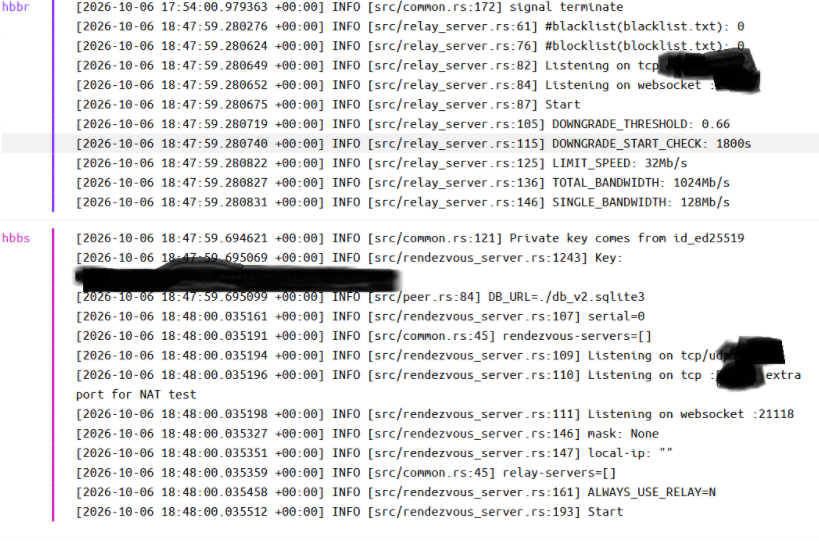

# RustDesk Việt Hóa & Triển Khai Server Riêng

> **Đồ án Seminar – Tuần 1**  
> Nhiệm vụ: Tải mã nguồn, tìm hiểu cấu trúc RustDesk và triển khai RustDesk Server trên Docker Desktop.

---

## 📌 Tổng quan

Trong tuần 1, nhóm tập trung vào việc tiếp cận mã nguồn **RustDesk**, tìm hiểu cấu trúc dự án, xác định các thành phần công nghệ chính và bước đầu triển khai hệ thống RustDesk Server bằng Docker Desktop.

### 🎯 Mốc bàn giao tuần 1

> **Kết nối thành công 2 máy thông qua RustDesk Server riêng.**

Kết quả cuối tuần: **Đã kết nối 2 máy thành công.** ✅

---

## 1. 📥 Tải mã nguồn RustDesk

Mã nguồn được lấy trực tiếp từ repository chính thức của RustDesk:

```bash
git clone https://github.com/rustdesk/rustdesk.git
```

Sau khi clone, nhóm tiến hành khảo sát cấu trúc source code để xác định vị trí của giao diện người dùng, tài nguyên ngôn ngữ và các thành phần phục vụ build.

---

## 2. 🏗️ Thành phần & công nghệ

| Thành phần | Công nghệ |
|---|---|
| Ngôn ngữ chính | **Rust** |
| Giao diện cũ | **Rust + Sciter** |
| Giao diện mới | **Flutter / Dart** |
| Build system cho Rust | **Cargo** |
| Build system cho UI mới | **Flutter SDK** |

### 📂 Các thư mục quan trọng

#### Giao diện người dùng

- `src/ui/` — giao diện cũ, sử dụng **Sciter**
- `flutter/lib/` — giao diện mới, sử dụng **Flutter**

#### Tài nguyên ngôn ngữ

```text
src/lang/
```

Đây là vị trí tài nguyên ngôn ngữ/bản dịch của giao diện cũ.

#### Build trên Windows

Hướng dẫn build trên Windows được tham khảo trong:

```text
Readme.md
```

của repository RustDesk.

---

## 3. 🎨 Các chức năng dự kiến tùy biến

Dựa trên định hướng của đồ án Seminar, nhóm dự kiến tùy biến một số thành phần của RustDesk:

| STT | Chức năng dự kiến tùy biến | Mục đích |
|---:|---|---|
| 1 | 🇻🇳 Giao diện tiếng Việt hoàn chỉnh tương tự AnyDesk | Phục vụ người dùng Việt |
| 2 | 🖥️ Màn hình cấu hình server riêng mặc định | Phục vụ việc triển khai server riêng |
| 3 | 🏷️ Logo và tên thương hiệu riêng | Phù hợp với đồ án Seminar |
| 4 | 🔐 Tích hợp VPN bảo mật | Tăng cường bảo mật kết nối |
| 5 | 🧹 Ẩn các tính năng không sử dụng | Đơn giản hóa giao diện cho doanh nghiệp |

> **Lưu ý:** Đây là các chức năng **dự kiến tùy biến**, chưa phải toàn bộ các chức năng đã hoàn thành trong tuần 1.

---

## 4. 🐳 Triển khai RustDesk Server

Trong quá trình triển khai, nhóm đã thành công chạy được hai container quan trọng của RustDesk Server:

```text
hbbs
hbbr
```

### Vai trò

- **hbbs** — RustDesk ID / rendezvous server.
- **hbbr** — RustDesk relay server.

Việc triển khai được thực hiện trên **Docker Desktop**.

---

## 5. ⚠️ Khó khăn gặp phải

### Mô hình mạng ban đầu

Trong quá trình thử nghiệm, nhóm gặp vấn đề khi cho máy ảo VMware kết nối đến RustDesk Server đang chạy trong WSL2 thông qua Docker Desktop.

Mô hình mạng phát sinh nhiều lớp NAT:

```text
VMware VM
   │
   │ VMware NAT
   ▼
Windows Host
   │
   │ WSL2 NAT
   ▼
WSL2
   │
   │ Docker NAT
   ▼
Docker Container
   │
   ├── hbbs
   └── hbbr
```

Cụ thể:

```text
VMware VM: 192.168.106.x
        ↓
Windows Host
        ↓
WSL2: 172.x.x.x
        ↓
Docker Container
```

### Nguyên nhân

Docker Desktop không tự động mở các port của container để các máy trong mạng/LAN hoặc máy ảo VMware có thể truy cập trực tiếp theo mô hình triển khai trên.

Do đó:

> **VMware VM không thể trực tiếp kết nối đến RustDesk Server đang chạy trong WSL2/Docker.**

---

## 6. 🔧 Cách khắc phục

Nhóm đã thực hiện cấu hình lại `compose.yml`, đồng thời mở các port cần thiết trên Windows Firewall.

### 6.1. Mở port Windows Firewall

Đối với **hbbs**:

```powershell
New-NetFirewallRule -DisplayName "RustDesk hbbs" `
-Direction Inbound `
-Protocol TCP `
-LocalPort <các port> `
-Action Allow
```

Đối với **hbbr**:

```powershell
New-NetFirewallRule -DisplayName "RustDesk hbbr" `
-Direction Inbound `
-Protocol TCP `
-LocalPort <các port> `
-Action Allow
```

Việc cấu hình Firewall cho phép VMware VM và các máy trong LAN truy cập vào các port cần thiết của RustDesk Server.

---

### 6.2. Thiết lập Port Proxy

Nhóm sử dụng `netsh interface portproxy` để chuyển tiếp port từ Windows Host đến địa chỉ IP của WSL2:

```powershell
netsh interface portproxy add v4tov4 `
listenport=<port> `
listenaddress=0.0.0.0 `
connectport=<port> `
connectaddress=<WSL_IP>
```

Mô hình sau khi cấu hình:

```text
VMware VM / LAN
       │
       ▼
Windows Host
       │
       │ Port Proxy
       ▼
WSL2
       │
       ▼
Docker
       │
       ├── hbbs
       └── hbbr
```

---

## 7. ✅ Kết quả tuần 1

### Checklist

- [x] Clone mã nguồn RustDesk
- [x] Tìm hiểu ngôn ngữ và công nghệ sử dụng
- [x] Tìm hiểu cấu trúc giao diện RustDesk
- [x] Xác định vị trí tài nguyên ngôn ngữ
- [x] Tìm hiểu hướng dẫn build trên Windows
- [x] Xác định các chức năng dự kiến tùy biến
- [x] Triển khai container `hbbs`
- [x] Triển khai container `hbbr`
- [x] Xử lý vấn đề kết nối giữa VMware → WSL2 → Docker
- [x] Cấu hình Windows Firewall
- [x] Cấu hình `netsh portproxy`
- [x] **Kết nối thành công 2 máy**

### 🟢 Trạng thái

**HOÀN THÀNH MỐC TUẦN 1**

> RustDesk Server đã được triển khai và hai máy đã kết nối thành công thông qua hệ thống server được cấu hình riêng.

---

## 8. 📊 Tiến độ

```text
Tải mã nguồn                 ████████████████████  100%
Tìm hiểu cấu trúc RustDesk   ████████████████████  100%
Triển khai hbbs              ████████████████████  100%
Triển khai hbbr              ████████████████████  100%
Xử lý kết nối mạng           ████████████████████  100%
Kết nối 2 máy                ████████████████████  100%
```

---

## 9. 🚀 Định hướng tiếp theo

Sau khi hoàn thành mốc kết nối 2 máy, nhóm có thể tiếp tục triển khai các nội dung theo phạm vi đồ án:

- Việt hóa giao diện RustDesk.
- Tùy biến logo và tên thương hiệu.
- Hoàn thiện màn hình cấu hình server riêng.
- Tiếp tục nghiên cứu cơ chế kết nối và relay của RustDesk.
- Nghiên cứu phương án bảo mật/VPN.
- Xác định và ẩn các tính năng không cần thiết.
- Tiếp tục kiểm thử hệ thống trong các mô hình mạng khác nhau.

---

## 👥 Thông tin dự án

**Tên đề tài:** Việt hóa và xây dựng công cụ Remote Access như AnyDesk từ RustDesk

**Môn học:** Seminar chuyên đề

**Nền tảng:** RustDesk

**Ngôn ngữ chính:** Rust

**UI:** Flutter / Dart, Sciter

**Server:** RustDesk `hbbs` / `hbbr`

**Container:** Docker

---

## 📝 Nhật ký tuần 1

| Hạng mục | Trạng thái |
|---|---|
| Khảo sát source code | ✅ Hoàn thành |
| Khảo sát công nghệ | ✅ Hoàn thành |
| Khảo sát UI | ✅ Hoàn thành |
| Docker `hbbs` | ✅ Hoàn thành |
| Docker `hbbr` | ✅ Hoàn thành |
| Xử lý NAT | ✅ Hoàn thành |
| Firewall | ✅ Hoàn thành |
| Port Proxy | ✅ Hoàn thành |
| Kết nối 2 máy | ✅ Thành công |

---

> **Cập nhật:** Tuần 1  
> **Trạng thái:** 🟢 Hoàn thành  
> **Mục tiêu quan trọng:** Kết nối thành công 2 máy qua RustDesk Server riêng.


---

---

## 10. 🛠️ Tuần 2: Build RustDesk Client gốc

> **Mốc bàn giao tuần 2:** Build thành công file `rustdesk.exe` từ mã nguồn trên Windows.

### 🎯 Mục tiêu tuần 2

- Cập nhật `compose.yml` có chú thích rõ ràng.
- Viết script tự động cập nhật port proxy.
- Xây dựng môi trường build hoàn chỉnh.
- **Build thành công RustDesk Client gốc.**

### ✅ Kết quả cuối tuần 2

> **Đã build thành công `rustdesk.exe` (release mode) sau khi vượt qua 5 lỗi lớn.**

---

### 10.1. 🧰 Cài đặt môi trường build

| Bước | Công cụ | Ghi chú |
|---|---|---|
| 1 | **Rust (rustup)** | Cài qua `rustup-init.exe`, chọn default |
| 2 | **Visual Studio Build Tools 2022** | Tick `Desktop development with C++`, `Windows 10/11 SDK`, `C++ CMake tools for Windows` (~5GB) |
| 3 | **LLVM** | Tải từ releases.llvm.org, **tick "Add LLVM to system PATH"** |
| 4 | **Flutter SDK** | Giải nén vào `D:\enviroment\flutter`, thêm vào System PATH |
| 5 | **vcpkg** | Clone về `D:\enviroment\vcpkg`, chạy `bootstrap-vcpkg.bat` |

**Cấu hình biến môi trường:**

```powershell
# Thêm vcpkg vào PATH
$machinePath = [System.Environment]::GetEnvironmentVariable('Path', 'Machine')
[System.Environment]::SetEnvironmentVariable('Path', "$machinePath;D:\enviroment\vcpkg", 'Machine')

# Trỏ tới libclang
setx LIBCLANG_PATH "D:\enviroment\LLVM\bin"

# Trỏ tới vcpkg root
setx VCPKG_ROOT "D:\enviroment\vcpkg"
```

> ⚠️ **Lưu ý:** Sau khi `setx`, phải đóng và mở lại PowerShell (hoặc khởi động lại máy) để biến môi trường có hiệu lực.

### 10.2. 📦 Cài đặt các thư viện C++ phụ trợ qua vcpkg

RustDesk cần một số thư viện C++ để xử lý video/audio. Mở PowerShell với quyền Administrator và chạy:

```powershell
cd D:\enviroment\vcpkg

# Cài các thư viện cho chế độ build tĩnh (static)
.\vcpkg install libvpx:x64-windows-static
.\vcpkg install opus:x64-windows-static
.\vcpkg install libyuv:x64-windows-static
.\vcpkg install aom:x64-windows-static

# Tích hợp vcpkg vào hệ thống
.\vcpkg integrate install
```

⏱️ **Thời gian:** Quá trình này có thể mất 1.5 – 2 giờ tùy cấu hình máy. Riêng `aom` mất khoảng 1.1 giờ vì phải biên dịch từ mã nguồn.

### 10.3. 🚀 Lệnh build chính thức

```powershell
cd "D:\HKI 2026-2027\Seminar\seminar_rustdk\rustdesk"

# Dọn dẹp cache cũ (nếu đã từng build lỗi)
cargo clean

# Build release KHÔNG dùng cờ --features "inline"
cargo build --release
```

**Kết quả thành công:**

```text
Finished `release` profile [optimized] target(s) in 1m 09s
```

**File thành phẩm nằm tại:**

```text
D:\HKI 2026-2027\Seminar\seminar_rustdk\rustdesk\target\release\rustdesk.exe
```

**Các file đi kèm quan trọng:**

- `rustdesk.exe` — Giao diện chính
- `service.exe` — Chạy ngầm dưới quyền SYSTEM
- `naming.exe` — Công cụ đặt tên thiết bị
- `librustdesk.dll` và các file `.dll` phụ trợ khác

### 10.4. ⚠️ Khó khăn gặp phải & Cách khắc phục

Quá trình build gặp 5 lỗi lớn liên tiếp, đòi hỏi phải xử lý từng bước:

#### 🔴 Lỗi 1: LNK1108: cannot write file at 0x0

**Triệu chứng:**

```text
error: linking with `link.exe` failed: exit code: 1108
fatal error LNK1108: cannot write file at 0x0
```

**Nguyên nhân:** Trình liên kết `link.exe` không ghi được file tạm, thường do:

- Ổ cứng đầy (thư mục `D:\cargo-target` rất ngốn dung lượng).
- Phần mềm diệt virus chặn file `.tmp`.
- Thư mục `%TEMP%` bị lỗi.

**Cách khắc phục:**

- Dọn dẹp ổ cứng, đảm bảo còn ít nhất 20GB trống.
- Tắt tạm thời Windows Defender hoặc thêm `D:\cargo-target` vào danh sách loại trừ.
- Xóa toàn bộ file trong `%TEMP%` (nhấn `Win+R` → gõ `%temp%` → Enter).
- Chạy `cargo clean` rồi build lại.

#### 🔴 Lỗi 2: Unable to find libclang

**Triệu chứng:**

```text
Unable to find libclang: "couldn't find any valid shared libraries matching:
['clang.dll', 'libclang.dll'], set the `LIBCLANG_PATH` environment variable..."
```

**Nguyên nhân:** Thư viện `bindgen` (dùng để chuyển C++ header sang Rust) cần `libclang` nhưng chưa tìm thấy.

**Cách khắc phục:**

- Tải LLVM từ releases.llvm.org.
- Cài đặt, tick chọn **Add LLVM to the system PATH**.
- Set biến môi trường:

```powershell
setx LIBCLANG_PATH "D:\enviroment\LLVM\bin"
```

- Khởi động lại máy hoặc đóng/mở PowerShell mới.
- Kiểm tra file `libclang.dll` có tồn tại trong `D:\enviroment\LLVM\bin` không.

#### 🔴 Lỗi 3: `vpx/vp8.h` file not found và `opus/opus_multistream.h` file not found

**Triệu chứng:**

```text
fatal error: 'vpx/vp8.h' file not found
fatal error: 'opus/opus_multistream.h' file not found
```

**Nguyên nhân:** Thiếu thư viện xử lý video (`libvpx`) và âm thanh (`opus`).

**Cách khắc phục:**

```powershell
cd D:\enviroment\vcpkg
.\vcpkg install libvpx:x64-windows-static
.\vcpkg install opus:x64-windows-static
.\vcpkg install libyuv:x64-windows-static
```

#### 🔴 Lỗi 4: `aom/aom.h` file not found

**Triệu chứng:**

```text
fatal error: 'aom/aom.h' file not found
panicked at libs\scrap\build.rs:161:18
```

**Nguyên nhân:** Thư viện `scrap` (chụp màn hình) cần codec AV1 (`aom`).

**Cách khắc phục:**

```powershell
cd D:\enviroment\vcpkg
.\vcpkg install aom:x64-windows-static
.\vcpkg integrate install
```

⏱️ **Lưu ý:** `aom` mất khoảng 1.1 giờ để build xong.

#### 🔴 Lỗi 5: file not found for module `inline`

**Triệu chứng:**

```text
error[E0583]: file not found for module `inline`
  --> src\ui.rs:21:1
   |
21 | pub mod inline;
   | ^^^^^^^^^^^^^^^
```

**Nguyên nhân:** Cờ `--features "inline"` yêu cầu module `inline` (dùng cho Web Client) mà mã nguồn tải về không có.

**Cách khắc phục:** Bỏ cờ `--features "inline"` trong lệnh build.

```powershell
# SAI
cargo build --release --features "inline"

# ĐÚNG
cargo build --release
```

### 10.5. 📋 Tổng kết hành trình xử lý lỗi

| # | Lỗi | Cách khắc phục | Trạng thái |
|---:|---|---|---|
| 1 | LNK1108 - `link.exe` | Dọn ổ cứng, tắt antivirus, xóa `%TEMP%` | ✅ |
| 2 | `libclang` not found | Cài LLVM + set `LIBCLANG_PATH` | ✅ |
| 3 | `vpx/opus` not found | `vcpkg install libvpx opus libyuv` | ✅ |
| 4 | `aom` not found | `vcpkg install aom` | ✅ |
| 5 | `inline` module not found | Bỏ cờ `inline` | ✅ |

### 🟢 Trạng thái tuần 2

> **HOÀN THÀNH MỐC TUẦN 2**

RustDesk Client đã được build thành công từ mã nguồn trên Windows, sẵn sàng cho giai đoạn tùy biến.

---

---

## 11. 🛠️ Tuần 3: Việt hóa Client và thiết lập WireGuard VPN

> **Ngày cập nhật:** 2026-10-26  
> **Phạm vi:** Nhiệm vụ Bạn 1 (Client) và Bạn 2 (Server)  
> **Mốc bàn giao tuần 3:** Có bản Client đã tùy biến để kiểm thử; WireGuard VPN thử nghiệm hoạt động và định tuyến được tới các dịch vụ RustDesk trong Docker.

### 11.1. 🎯 Mục tiêu tuần 3

| Vai trò | Nhiệm vụ | Mục tiêu kiểm chứng |
|---|---|---|
| **Bạn 1 – Client** | Việt hóa các phần giao diện đã xử lý, thay logo và tên ứng dụng | Chạy được bản Windows đã tùy biến; kiểm tra kết nối với RustDesk Server riêng của nhóm |
| **Bạn 2 – Server** | Refactor `compose.yml` dùng biến môi trường; triển khai WireGuard bằng Docker Desktop | Các container `hbbs`, `hbbr`, `wireguard` hoạt động; Ubuntu VMware kết nối VPN và truy cập được dịch vụ RustDesk qua tuyến VPN |

> **Lưu ý về phạm vi:** Bản Client được dùng để kiểm thử là bản Windows đã tùy biến của nhóm (Vynex). Ubuntu VMware sử dụng RustDesk Client chính thức làm máy thử nghiệm; không cần pull mã nguồn và build lại trong Ubuntu chỉ để kiểm tra khả năng tương thích mạng.

### 11.2. 🎨 Bạn 1 – Việt hóa và tùy biến Client

Các nội dung đã thực hiện:

- Chỉnh sửa các chuỗi ngôn ngữ cần Việt hóa trong mã nguồn.
- Thay logo/icon theo nhận diện của nhóm.
- Đổi tên ứng dụng hiển thị thành **Vynex**.
- Build và chạy bản Client Windows đã tùy biến.
- Dùng Vynex kết nối với RustDesk Server riêng của nhóm; sau khi chuẩn hóa địa chỉ server và Public Key, kết nối điều khiển hai chiều giữa Vynex trên Windows và RustDesk Client trên Ubuntu VMware đã thành công.

Các vùng mã nguồn/tài nguyên liên quan đã được làm việc gồm `src/lang/vi.rs` và tài nguyên nhận diện ở `flutter/windows/runner/` (bao gồm `Runner.rc` và icon). Đường dẫn cần đối chiếu với phiên bản source hiện tại nếu có thay đổi tiếp theo.

> 📸 **CẦN BỔ SUNG ẢNH MINH CHỨNG 3.1 – Giao diện Vynex:**
 
 
*từ vmware sang host*
 
*từ host sang vmware*

Thư mục triển khai server hiện tại:

```text
D:\HKI 2026-2027\Seminar\seminar_rustdk\server
```

File `.env` được đặt cùng cấp với `compose.yml`, chứa các biến dùng trong môi trường kiểm thử LAN/VMware:

```dotenv
RELAY_ADDR=192.168.106.1
WG_SERVER_URL=192.168.106.1
```

Trong `compose.yml`, `hbbs` sử dụng biến `RELAY_ADDR` để khai báo địa chỉ relay:

```yaml
command: hbbs -r ${RELAY_ADDR}:21117
```

Service `wireguard` được thêm vào Compose, sử dụng image `linuxserver/wireguard:latest`, lưu cấu hình trong `./wireguard-config:/config` và publish UDP `51820`.

Các cổng đã publish trong cấu hình đang kiểm thử:

| Service | Cổng | Giao thức | Mục đích |
|---|---:|---|---|
| `hbbs` | `21115` | TCP | NAT type test |
| `hbbs` | `21116` | TCP + UDP | ID / rendezvous |
| `hbbs` | `21118` | TCP | WebSocket |
| `hbbr` | `21117` | TCP | Relay |
| `hbbr` | `21119` | TCP | WebSocket relay |
| `wireguard` | `51820` | UDP | WireGuard VPN |

Kiểm tra trạng thái container bằng:

```powershell
docker compose ps
docker compose logs --tail=100 wireguard
```

Kết quả đã quan sát: `hbbs`, `hbbr` và `wireguard` đều ở trạng thái `Up`. Log WireGuard cho biết tunnel `wg0` được kích hoạt.

 


### 11.4. 🔐 WireGuard VPN bằng Docker Desktop

#### Mô hình kiểm thử

```text
Ubuntu VMware (WireGuard Client)
  IP VMnet8: 192.168.106.128
  IP VPN:    10.13.13.2
          |
          | VMware NAT / VMnet8
          v
Windows Host (Docker Desktop)
  IP VMnet8: 192.168.106.1
          |
          | UDP 51820 được publish vào Docker
          v
WireGuard container
  Docker IP: 172.20.0.3
  IP VPN:    10.13.13.1
          |
          | Docker network: server_rustdesk-net
          +--------------------------+
          |                          |
          v                          v
hbbs: 172.20.0.2              hbbr: 172.20.0.4
TCP 21116                     TCP 21117
```

> Các địa chỉ `172.20.0.x` là IP container trong lần kiểm thử này; IP có thể thay đổi nếu network/container được tạo lại. `192.168.106.1` là địa chỉ adapter VMware VMnet8 của Windows Host, không phải IP Wi-Fi (`192.168.1.5`) và không phải IP công khai trên Internet.

#### Cấu hình và xác nhận VPN

- WireGuard Server chạy trong container `wireguard` trên Docker Desktop.
- Ubuntu VMware cài `wireguard-tools` và dùng cấu hình client được tạo trong thư mục `wireguard-config/peer1/peer1.conf`; cấu hình được chép sang `/etc/wireguard/wg0.conf` trên Ubuntu.
- Địa chỉ VPN Server: `10.13.13.1`; địa chỉ VPN Client: `10.13.13.2`.
- Client được cấu hình route tới mạng VPN `10.13.13.0/24` và Docker network `172.20.0.0/16` qua `wg0`.
- Sau khi tunnel bắt tay thành công, `sudo wg show` trên Ubuntu có `latest handshake` và số byte gửi/nhận tăng; `docker exec wireguard wg show` cũng hiển thị handshake của peer.

Kiểm tra IP VPN Server:

```bash
ping -c 4 10.13.13.1
```

Kết quả kiểm thử đã đạt: **4 gói gửi, 4 gói nhận, 0% packet loss**.

 

### 11.5. 🧪 Kiểm chứng định tuyến từ VPN tới RustDesk Server

Các container trong Docker network của lần thử nghiệm có địa chỉ:

| Container | IP Docker | Cổng thử nghiệm |
|---|---|---:|
| `hbbs` | `172.20.0.2` | TCP `21116` |
| `wireguard` | `172.20.0.3` | UDP `51820` được publish ra Windows |
| `hbbr` | `172.20.0.4` | TCP `21117` |

Khi WireGuard bật, Ubuntu chạy:

```bash
ip route get 172.20.0.2
ip route get 172.20.0.4
nc -vz -w 3 172.20.0.2 21116
nc -vz -w 3 172.20.0.4 21117
```

Kết quả đã quan sát:

- `ip route get` trả về `dev wg0 src 10.13.13.2` cho cả hai địa chỉ container.
- Kết nối TCP tới `172.20.0.2:21116` thành công.
- Kết nối TCP tới `172.20.0.4:21117` thành công.

Để đối chứng, tắt WireGuard:

```bash
sudo wg-quick down wg0
ip route get 172.20.0.2
nc -vz -w 3 172.20.0.2 21116
nc -vz -w 3 172.20.0.4 21117
```

Khi VPN tắt, route chuyển sang `ens33` qua gateway `192.168.106.2` với source `192.168.106.128`; hai kết nối TCP tới IP nội bộ container bị timeout. Sau khi thử nghiệm, tunnel được bật lại bằng `sudo wg-quick up wg0`.

> **Kết luận có thể khẳng định:** Ubuntu VMware định tuyến tới các dịch vụ RustDesk ở IP nội bộ Docker qua `wg0` khi VPN bật; trong phép thử đối chứng khi VPN tắt, các kết nối TCP đó timeout.

> **Giới hạn cần ghi đúng trong báo cáo:** Phiên điều khiển RustDesk hai chiều đã được kiểm thử thành công bằng địa chỉ server publish trên Windows Host (`192.168.106.1`). Điều đó chưa chứng minh toàn bộ lưu lượng của phiên điều khiển RustDesk đi qua VPN, vì địa chỉ VMnet8 vẫn có thể được truy cập trực tiếp. Bằng chứng định tuyến qua VPN hiện tại đến từ các phép thử riêng với IP Docker `172.20.0.2` và `172.20.0.4`.


### 11.6. ⚠️ Khó khăn gặp phải và cách xử lý

| STT | Khó khăn / triệu chứng | Hướng xử lý | Kết quả |
|---:|---|---|---|
| 1 | Ubuntu VMware ban đầu ping `192.168.106.1` bị mất gói | Kiểm tra IP `ens33` (`192.168.106.128`) và VMnet8; thêm quy tắc Windows Firewall cho phép ICMP từ IP Ubuntu tới `192.168.106.1` để kiểm thử | Ping tới VMnet8 thành công |
| 2 | WireGuard Client gửi dữ liệu nhưng `0 B received`, không có `latest handshake` | Kiểm tra `wg show` ở cả client/server; phát hiện tunnel `WireGuardTunnel$peer1` trên Windows vẫn đang chạy trong khi dùng cùng cấu hình peer trên Ubuntu; tạm Deactivate tunnel Windows để Ubuntu làm client thử nghiệm duy nhất | Sau đó handshake xuất hiện ở cả hai đầu; ping `10.13.13.1` thành công |
| 3 | Cổng UDP `51820` xuất hiện cùng lúc trong danh sách endpoint Windows của `com.docker.backend.exe` và `wireguard.exe` | Xác minh tiến trình sở hữu cổng; tắt tunnel client `peer1` trên Windows trong lần thử nghiệm này, giữ container WireGuard chạy trên Docker Desktop | Sau đó VPN hoạt động. Ghi chú: không coi việc có hai endpoint là bằng chứng duy nhất về nguyên nhân; kết quả cải thiện được xác nhận sau khi tắt tunnel Windows |
| 4 | `tcpdump` trong network namespace container không thấy gói UDP trong lần bắt đầu đầu tiên | Chuyển sang kiểm tra gói ở Windows với `pktmon`, kiểm tra port publish và tiến trình giữ UDP `51820` | Xác nhận Windows nhìn thấy gói UDP từ `192.168.106.128` tới `192.168.106.1:51820`; tiếp tục xử lý tunnel peer và sau đó handshake thành công |
| 5 | Vynex Windows điều khiển Ubuntu báo `Relay failed` trong khi chiều ngược lại hoạt động | Chuẩn hóa cấu hình ID Server/Relay Server trên cả hai client; dùng Public Key RustDesk chính xác lấy từ `data/id_ed25519.pub`, không nhập lại bằng tay; kiểm tra cổng relay | Kết nối điều khiển hai chiều thành công |
| 6 | Log WireGuard có một số lỗi CoreDNS `i/o timeout` | Tiếp tục dùng địa chỉ IP để kiểm tra handshake, ping và TCP; ghi nhận DNS cần kiểm tra thêm nếu sau này dùng domain/tên máy | Các bài kiểm thử bằng IP thành công; chưa ghi nhận DNS đã được xử lý triệt để |

> **Bảo mật:** Không đưa `PrivateKey`, `PresharedKey` hoặc file cấu hình WireGuard đầy đủ vào README, ảnh chụp hoặc Git. Chỉ chụp trạng thái và số liệu kiểm thử; che các khóa nếu ứng dụng hiển thị chúng.

### 11.7. ✅ Kết quả cuối cùng và mốc bàn giao tuần 3

| Hạng mục | Kết quả | Trạng thái |
|---|---|---|
| Việt hóa các phần giao diện đã xử lý | Đã cập nhật và chạy thử bản Client Windows | ✅ Đạt phần đã thực hiện; cần rà soát toàn bộ chuỗi nếu yêu cầu “thuần Việt” hoàn chỉnh |
| Thay logo và tên ứng dụng | Bản build Windows hiển thị nhận diện Vynex | ✅ Đã kiểm thử |
| Refactor `compose.yml` dùng `.env` | `hbbs` sử dụng `RELAY_ADDR`; có `WG_SERVER_URL` cho cấu hình WireGuard | ✅ Đã cấu hình |
| Triển khai WireGuard bằng Docker Desktop | Container `wireguard` hoạt động trên UDP `51820` | ✅ Đạt |
| Handshake giữa Ubuntu VMware và WireGuard Server | Có `latest handshake`, tăng transfer; ping `10.13.13.1` thành công | ✅ Đạt |
| Định tuyến tới `hbbs`/`hbbr` qua WireGuard | TCP `21116` và `21117` tới IP nội bộ Docker thành công khi VPN bật; timeout khi VPN tắt | ✅ Đạt |
| RustDesk Client kết nối server riêng | Vynex Windows và RustDesk Ubuntu điều khiển hai chiều thành công | ✅ Đạt; đường đi toàn bộ phiên qua VPN chưa được chứng minh |

#### Checklist nghiệm thu tuần 3

- [x] Việt hóa các phần giao diện đã chỉnh sửa.
- [x] Thay logo và tên ứng dụng Vynex.
- [x] Build và chạy thử Client Windows đã tùy biến.
- [x] Refactor cấu hình Compose dùng biến môi trường `.env`.
- [x] Chạy `hbbs`, `hbbr` và `wireguard` bằng Docker Desktop.
- [x] WireGuard handshake thành công giữa Ubuntu VMware và Server.
- [x] Ping thành công IP VPN `10.13.13.1`.
- [x] Truy cập TCP `hbbs`/`hbbr` qua IP nội bộ Docker khi VPN bật.
- [x] Đối chứng: các kết nối tới IP Docker timeout khi VPN tắt.
- [x] Kiểm thử kết nối RustDesk hai chiều tới server riêng.
- [ ] Nếu cần tuyên bố “toàn bộ phiên điều khiển đi qua VPN”, thực hiện thêm bài kiểm thử đường truyền của chính phiên RustDesk và lưu bằng chứng riêng.

### 🟢 Trạng thái tuần 3

> **HOÀN THÀNH MỐC CỐT LÕI TUẦN 3 CHO BẠN 1 VÀ BẠN 2.**
>
> Bản Client Windows đã tùy biến được chạy thử; WireGuard VPN chạy bằng Docker Desktop đã hoạt động; Ubuntu VMware đã truy cập được các dịch vụ `hbbs` và `hbbr` qua tuyến VPN. RustDesk Client trên Windows và Ubuntu cũng đã điều khiển hai chiều thông qua server riêng của nhóm. Phạm vi xác minh đường truyền được ghi rõ ở mục 11.5 để tránh khẳng định quá mức về toàn bộ lưu lượng phiên điều khiển.

> 📸 **CẦN BỔ SUNG ẢNH MINH CHỨNG 3.8 – Mốc bàn giao:** Chụp ảnh kết nối điều khiển hai chiều thành công và đặt tại cuối mục này.

---

## 12. 📊 Tiến độ tổng thể sau tuần 3

```text
Tuần 1:
Tải mã nguồn và tìm hiểu cấu trúc       ████████████████████ 100%
Triển khai hbbs/hbbr                    ████████████████████ 100%
Kết nối hai máy                         ████████████████████ 100%

Tuần 2:
Cài môi trường build Windows            ████████████████████ 100%
Cài vcpkg và dependencies               ████████████████████ 100%
Build RustDesk Client gốc               ████████████████████ 100%

Tuần 3 – Bạn 1:
Việt hóa các phần giao diện đã chỉnh sửa ████████████████████ 100% phần đã thực hiện
Thay logo và tên Vynex                   ████████████████████ 100%
Chạy thử Client Windows đã tùy biến      ████████████████████ 100%

Tuần 3 – Bạn 2:
Refactor Compose dùng .env              ████████████████████ 100%
WireGuard chạy bằng Docker Desktop      ████████████████████ 100%
Handshake và ping VPN                   ████████████████████ 100%
Định tuyến VPN tới hbbs/hbbr             ████████████████████ 100%
Kiểm thử RustDesk hai chiều              ████████████████████ 100%
Xác minh toàn bộ phiên điều khiển qua VPN CẦN KIỂM THỬ RIÊNG
```

---

## 13. 📸 Danh sách ảnh minh chứng cần chèn

Để README dễ nghiệm thu, nên bổ sung các ảnh theo đúng vị trí đánh dấu ở trên:

| Mã ảnh | Nội dung cần chụp | Vị trí chèn |
|---|---|---|
| 3.1 | Bản Vynex Windows chạy thực tế, có tên/logo mới và giao diện đã Việt hóa | Mục 11.2 |
| 3.2 | Kết nối điều khiển hai chiều: Vynex Windows ↔ Ubuntu VMware | Mục 11.2 |
| 3.3 | `docker compose ps` hiển thị `hbbs`, `hbbr`, `wireguard` đều `Up` | Mục 11.3 |
| 3.4 | `docker exec wireguard wg show` có peer/handshake | Mục 11.3 |
| 3.5 | `sudo wg show` có `latest handshake` và ping `10.13.13.1` thành công | Mục 11.4 |
| 3.6 | `ip route get` dùng `wg0` và hai cổng TCP truy cập thành công khi VPN bật | Mục 11.5 |
| 3.7 | Route đi qua `ens33` và kết nối TCP tới IP Docker timeout khi VPN tắt | Mục 11.5 |
| 3.8 | Ảnh tổng hợp kết quả điều khiển RustDesk hai chiều | Mục 11.7 |

> Khi chèn ảnh, thay từng dòng `📸 CẦN BỔ SUNG ẢNH MINH CHỨNG` bằng ảnh thực tế, ví dụ ``. Không chụp hoặc đăng công khai Private Key, Preshared Key hay toàn bộ cấu hình WireGuard.

---

## 14. 🗓️ Nhật ký tổng kết tuần 3

| Hạng mục | Trạng thái | Ghi chú |
|---|---|---|
| Client tùy biến | ✅ Đã chạy thử | Việt hóa các phần đã chỉnh, logo và tên Vynex |
| RustDesk Server bằng Docker | ✅ Đang hoạt động | `hbbs` / `hbbr` giữ vai trò server riêng |
| WireGuard VPN | ✅ Đã kiểm chứng | Ubuntu VMware có handshake và ping VPN Server thành công |
| Định tuyến qua Docker network | ✅ Đã đối chứng | Thành công khi VPN bật; timeout khi VPN tắt |
| Kết nối RustDesk hai chiều | ✅ Thành công | Dùng server riêng; cần tách bạch với kết luận toàn bộ phiên đi qua VPN |
| Công việc cần theo dõi | 🟡 Theo dõi tiếp | DNS timeout trong log và bài kiểm thử riêng cho luồng relay/phiên điều khiển qua VPN nếu giảng viên yêu cầu |

> **Cập nhật:** Tuần 3  
> **Trạng thái:** 🟢 Hoàn thành mốc cốt lõi của Bạn 1 và Bạn 2  
> **Mốc bàn giao:** Client Windows đã tùy biến chạy được; WireGuard VPN hoạt động; Ubuntu VMware truy cập được `hbbs`/`hbbr` qua tuyến VPN; hai client kết nối RustDesk hai chiều với server riêng.
